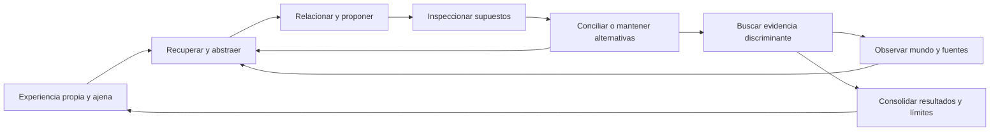
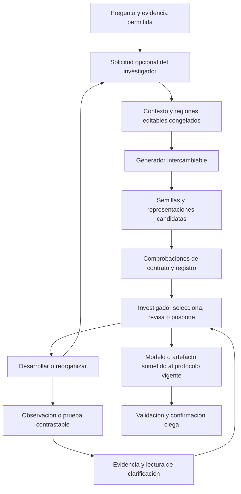

# SPEC · Generación de hipótesis: desarrollar y reorganizar representaciones

**Documento de investigación, no plan de implementación vigente.** La propuesta acotada para la librería está en
[SPEC-Y-SI.md](SPEC-Y-SI.md): dos primitivas opcionales para pedir una nueva dirección y aprender a usarlas entre mundos.
Los componentes y contratos de este documento quedan como alternativas de investigación, no como dependencias de esa entrega.

Estado (19/10/2026): **propuesta de investigación e integración; sin implementar ni elegir un modelo ganador**.
Versión consolidada: sistema independiente del arnés, centrado en desarrollar y reorganizar representaciones;
clarificación por evidencia, semillas incipientes y relaciones entre dominios. NCP, LCM y difusión son candidatos
tecnológicos; la integración local es una opción de despliegue.
Autoría: propuesta elaborada a petición del autor del arnés. Las decisiones de este documento requieren contraste;
no sustituyen los contratos actuales ni convierten una estrategia de investigación en obligación del investigador.

**Nota (27/10/2026): qué queda cubierto y qué no.**
- *Generación (HG1, HG2; etapas H0–H2):* cubierta por la búsqueda evolutiva (SPEC-DELEGACION-EVOLUTIVA,
  `lib/src/learn/evolve`), una rama de delegación con:
  - variación y selección de mecanismos con procedencia;
  - registro, reproducción, presupuestos y aislamiento.

  Validada y aparcada: en 3SUM atascado abrió mecanismos distintos de los del investigador, y éste adoptó uno y lo
  trabajó. La validación fue cualitativa; la comparación A2–A3 frente a generar sin estructura, a igual coste, no se
  ha hecho.
- *Dirección (HG7, HG8):* cuándo profundizar, contrastar o replantear, y qué semillas desarrollar, pasa a
  [SPEC-METAPOLITICA-INVESTIGACION.md](SPEC-METAPOLITICA-INVESTIGACION.md), con sus orientaciones
  `develop`, `contrast` y `reframe`.
- *Lo que queda como investigación, sin plan:*
  - HG3, la separación explicación, predicción y programa;
  - HG4, difusión;
  - HG5, una biblioteca de mecanismos entre problemas (`--experience` la roza);
  - HG6, NCP/LCM.

  HG4 y HG6 dependen de modelos que el arnés no tiene.

## 1. Pregunta y tesis de trabajo

**¿Cómo reconocemos que explorar una representación sigue aclarando el problema, y cómo proponemos otra que abra
explicaciones y experimentos nuevos cuando deja de hacerlo?**

Dos capacidades complementarias organizan la propuesta:

| Capacidad | Qué transforma | Ejemplos |
|---|---|---|
| **Desarrollar una representación** | El conocimiento dentro de las categorías actuales | Medir, deducir, ajustar, contrastar y resolver inconsistencias |
| **Reorganizar una representación** | Las categorías y relaciones con las que investigamos | Cambiar supuestos, introducir estado o entidades, trasladar una analogía, cambiar escala o reformular la pregunta |

No son necesariamente dos modelos, agentes ni fases alternadas por calendario. Un investigador puede ejercer ambas
en una misma intervención. Se distinguen para observar qué cambió y qué permitió investigar, no para imponerle un
estilo de razonamiento.

La tesis de diseño es que **la búsqueda prepara posibles reorganizaciones y una reorganización cambia la búsqueda
que podemos hacer después**. La «chispa» se trata como una semilla de reorganización que necesita desarrollo para
mostrar su utilidad. Esto reconcilia búsqueda sostenida e inspiración sin afirmar una teoría demostrada del cerebro.

La experiencia que motiva la pregunta es que un junior pequeño puede ejecutar investigación metódica cuando recibe
buenas orientaciones de un senior. Eso hace plausible un cuello de botella en la generación de explicaciones útiles.
No aísla todavía ese cuello: el senior también puede mejorar la selección de experimentos, la representación, la
memoria y la distribución del esfuerzo. No se afirma que generar hipótesis sea la única frontera de la inteligencia.

Hipótesis que esta propuesta quiere distinguir:

- **HG1, generación:** un conjunto diverso de hipótesis explícitas mejora los resultados del mismo investigador.
- **HG2, estructura:** analogías y transformaciones de mecanismos aportan más que pedir más muestras al mismo modelo.
- **HG3, representación:** separar explicación, predicción y programa facilita investigar y transferir lo aprendido.
- **HG4, difusión:** completar regiones editables mediante difusión aporta utilidad adicional frente a completarlas
  con un modelo autorregresivo. Es una pregunta experimental, no un supuesto de HG1–HG3.
- **HG5, acumulación:** reutilizar mecanismos y fracasos de investigaciones anteriores ayuda en problemas nuevos.
- **HG6, representación latente:** un modelo entrenado con predicción de conceptos aporta propuestas útiles que no
  obtenemos de una alternativa comparable. No se presupone que sus códigos latentes sean conceptos interpretables.
- **HG7, dirección:** observar clarificación y límites de observabilidad ayuda a decidir cuándo profundizar, cambiar
  de instrumento, explorar otra representación o suspender una línea, frente a continuar sin esa lectura.
- **HG8, fertilidad:** desarrollar semillas que abren diferencias investigables aporta más que seleccionar por
  sorpresa, distancia entre dominios o puntuación de plausibilidad solamente.

La hipótesis de valor sigue siendo la del mundo de artefactos: **soluciones interpretables e investigación reconstruible**.
El coste delimita la viabilidad y debe medirse, pero no reemplaza ese objetivo.

## 2. Investigación externa: qué aporta y qué no demuestra

### 2.1 DiscoveryRSI: separar artículo, modelo y núcleo público

Revisión del repositorio en `8f7214865548bc9b48170aa844e205341d24c4b9`, sin instalar dependencias ni llamar a modelos.

El artículo propone hipótesis con planes, alternativas y criterios; evolución con procedencia; entrenamiento que
atribuye crédito a contribuciones y revisión del flujo de investigación. Su 6,3 % es correspondencia retrospectiva
accionable con literatura, **no tasa de descubrimientos confirmados**. La evaluación usa grupos distintos y juicios
correlacionados; el apéndice muestra sensibilidad a la recuperación documental. Son resultados prometedores sobre
formulación y desarrollo, no una demostración de creatividad general o de superioridad causal del método. [S1]

La implementación pública examinada es más pequeña:

| Pieza | Comportamiento observado | Consecuencia para nuestra integración |
|---|---|---|
| `core.py`, `Candidate` | Guarda afirmación, plan, alternativas, evidencias, padres y crítica | Útil como referencia de objeto; no prueba esas afirmaciones |
| `DiscoveryLoop.run` | Critica candidatos, elige el máximo y añade el ganador al historial | Selección escalar; no archivo explícito de diversidad ni contraste en un mundo |
| `harness.py`, `_candidates` | Introduce el ID del último padre; no serializa su afirmación, plan ni crítica | La ruta ordinaria no transmite el material necesario para una revisión informada del padre |
| `harness.py`, `_context` | Incluye descripciones de herramientas e instrucciones de roles truncadas | Describir herramientas no constituye ejecutarlas |
| `tools.py` | Registro invocable; manejadores básicos devuelven estructuras | El bucle de `ResearchHarness` no despacha llamadas a ese registro |
| `ReplayBuffer` | Guarda episodios y permite leer JSONL | `run()` no restaura desde ellos; no equivale al replay completo del arnés local |

Prueba local con adaptador simulado y dos episodios: el segundo prompt contenía el ID del padre, pero no sus
marcadores únicos de afirmación, plan ni crítica. No consumió inferencia. Los adaptadores de CLI pueden disponer de
capacidades propias; eso no añade automáticamente esas capacidades al contrato del núcleo inspeccionado.

En `src/` y `tests/` revisados no encontré implementación del entrenamiento HCO, compilación Harbor ni aceptación
experimental de cambios al propio harness. El artículo, el checkpoint publicado y este núcleo son entregas distintas.
**Recomendación: adoptar ideas y contratos útiles, no incorporar el repositorio entero como motor de investigación.**
Enlaces permanentes a los módulos inspeccionados: [S2a], [S2b], [S2c], [S2d].

### 2.2 Referencias complementarias

| Referencia | Aportación comprobada en la fuente | Aplicación propuesta aquí |
|---|---|---|
| AlphaEvolve [S3] | Evolución de programas mediante propuestas LLM y evaluación ejecutable | Archivo de variantes y feedback del mundo; una mejora de código no acredita por sí sola su explicación |
| Google Co-Scientist / Hypothesis Generation [S4] | Generación, revisión y evolución de propuestas; herramienta experimental publicada por Google Labs | Comparar propuestas y conservar varias líneas; una preferencia del juez no es evidencia experimental |
| Structure-mapping [S5] | Analogías representadas como correspondencias entre sistemas de relaciones | Hacer explícito qué relación se transfiere y qué observación la invalidaría |
| DreamCoder [S6] | Aprendizaje de abstracciones simbólicas y búsqueda de programas guiada por redes | Biblioteca versionada de mecanismos reutilizables; no exige que el programa final llame a un modelo neural |
| LLaDA / DiffuCoder [S7, S8] | Generación mediante difusión de tokens enmascarados, también aplicada a código | Backend experimental de completado; no evidencia de generación científica superior |
| Difusión con gramáticas [S9] | Restricciones sintácticas durante completado, incluidas múltiples regiones | Separar validez sintáctica de corrección semántica y evidencia sobre el mundo |
| DreamOn [S10] | Completado por difusión con longitud variable | Evitar asumir que una cantidad fija de máscaras expresa cualquier solución |

No se encontró en estas fuentes una demostración de que difusión supere a generación autorregresiva en la tarea
específica de producir hipótesis mecanísticas útiles para nuestros mundos. Tampoco se ejecutaron esos modelos aquí.

### 2.3 Next Concept Prediction y Large Concept Models

Hay al menos dos líneas diferentes bajo la palabra «concepto»:

- **ConceptLM / NCP (febrero de 2026):** aprende un vocabulario discreto mediante cuantización de estados internos
  agregados y añade predicción de conceptos al entrenamiento por tokens. No es simplemente solicitar a un LLM que
  escriba una lista de ideas. Sus resultados estudian modelado de lenguaje y benchmarks, no inspiración científica. [S11]
- **NCP-ArchPreview (septiembre de 2026):** escala la línea de predicción conjunta y realimenta las representaciones
  conceptuales hacia la generación de tokens. Es pertinente para explorar una capa generadora latente. El informe
  también investiga adaptación mediante el módulo VQ; esa posibilidad no equivale a editar un catálogo legible de
  mecanismos ni garantiza que cualquier checkpoint publicado exponga la misma capacidad. [S12]
- **LCM de Meta (diciembre de 2024):** usa embeddings SONAR de frases como unidad conceptual. Incluye variantes de
  regresión y difusión. Constituye un antecedente directo de generación por difusión a una escala superior al token,
  aunque una frase no sea necesariamente un concepto científico elemental. [S13]

La ficha Stage 2 de NCP-ArchPreview describe un modelo base de unos 8,9B parámetros, sin alineamiento conversacional,
que agrupa cuatro estados de token por concepto y propone completado o ejemplos few-shot. Esto favorece empezar
probándolo como componente especializado, no asumir que sustituye directamente a un investigador con herramientas. [S14]

**Aplicabilidad propuesta:** NCP como generador de explicaciones candidatas; LCM/difusión conceptual como exploración
de representaciones; un modelo con capacidad de herramientas puede coordinar su uso. No hay garantía de que las
representaciones aprendidas correspondan uno a uno a conceptos como «retardo» o «conservación». Para manipularlas
directamente habría que verificar acceso, estabilidad, decodificación y efecto causal de la intervención.

Evaluación en dos niveles: primero, calidad útil de las propuestas que emite el modelo sin intervenir sus estados;
después, si la implementación lo permite, cambios controlados del latente y su efecto sobre mecanismos expresados.
Una explicación textual de un latente no basta para demostrar qué representa. No se entrenan modelos ni se descargan
pesos como parte de esta revisión documental.

## 3. De la intuición a un mecanismo computable

### 3.1 Una analogía no es una semilla aleatoria

Conviene distinguir tres objetos que a veces se llaman «semilla»:

1. **Semilla aleatoria:** inicializa muestreo, máscaras o decisiones de decodificación. No tiene significado conceptual
   garantizado ni garantiza reproducibilidad exacta entre proveedores, dispositivos o versiones.
2. **Semilla conceptual:** una relación candidata: almacenamiento, retardo, conservación, saturación, realimentación,
   competencia, simetría. Es contexto explícito, con procedencia y alcance; no evidencia.
3. **Semilla de solución:** un programa, ecuación o grafo existente del que se permite modificar determinadas partes.

La intuición del autor se puede implementar como búsqueda condicionada sobre las dos últimas, diversificada por la primera.
No hace falta afirmar que así funciona el pensamiento humano ni que el ruido representa directamente conceptos.

Ejemplo construido para ilustrar el diseño, no hallazgo de un run:

- Observación: con la misma entrada actual aparecen respuestas distintas según la historia reciente.
- Analogía: un depósito almacena estado; mapear «contenido» a una variable latente y «fuga» a relajación.
- Hipótesis H1: existe memoria dinámica, `z[t+1] = a*z[t] + b*u[t]`, que afecta a la salida.
- Rival H2: la aparente memoria proviene de un retardo del instrumento.
- Predicción: cambiar el espaciado entre pulsos modifica la respuesta de maneras distintas bajo H1 y H2.
- Experimento: preregistrar ambas predicciones, calibrar la medición y ejecutar el protocolo permitido por el laboratorio.

El salto creativo candidato es introducir otra representación del problema. La prueba distingue si sirve.
Un ejemplo de relatividad puede inspirar esta idea de cambiar representación, pero no se utiliza como explicación
histórica ni como evidencia de que difusión modele la creatividad humana.

### 3.2 Operadores disponibles, no una receta obligatoria

Una política generadora puede pedir: extender una explicación, repararla ante un contraejemplo, combinar mecanismos,
trasladar una analogía, cambiar escala o coordenadas, introducir estado latente, buscar una alternativa instrumental,
simplificar o reiniciar sin padres. Son etiquetas abiertas para estudiar la búsqueda; el arnés no exige recorrerlas.

Los padres conceptuales, las fuentes consultadas y la versión de código editada son relaciones diferentes. Una fuente
de inspiración no se convierte automáticamente en antecesor científico ni en evidencia favorable.

### 3.3 Experiencia, observación, introspección y conciliación como herramientas

La inspiración puede investigarse como una transformación de experiencia en nuevas preguntas. Es hipótesis de diseño,
no explicación completa de la cognición. Parte de esa experiencia ya está implícita en los pesos del modelo; otra
puede hacerse recuperable en episodios propios, investigaciones ajenas y fuentes. No toda propuesta necesita una
consulta externa nueva, pero sí debe distinguir su fundamento de una asociación sugerida por el modelo.

| Capacidad propuesta | Entrada y resultado | Límite epistemológico |
|---|---|---|
| `observe` | Pregunta e instrumento → medición o fuente externa identificable | Una publicación es un informe de terceros, no una medición propia |
| `recall` | Problema o patrón → episodios, fracasos y fuentes pertinentes | Recuperación por similitud no prueba aplicabilidad |
| `inspect_reasoning` | Hipótesis y decisiones registradas → supuestos, contradicciones, lagunas | Inspecciona objetos y razones declaradas; no promete acceso fiel al pensamiento interno |
| `abstract` | Episodios → relación candidata con condiciones de validez | Comprimir puede borrar variables decisivas; conservar los originales |
| `relate` | Dos estructuras → correspondencias, incompatibilidades y predicciones transferidas | Una analogía es una propuesta, no evidencia favorable |
| `reconcile` | Explicaciones rivales y evidencia → acuerdo parcial, diferencia pendiente o revisión | No forzar consenso; preservar rivales que aún no se pueden discriminar |
| `propose` | Contexto, relaciones y restricciones → hipótesis o programas candidatos | Backend intercambiable: LLM, NCP, LCM, difusión o búsqueda simbólica |
| `test` | Predicciones y protocolo congelados → resultados que distinguen o dejan abierto | Usa un entorno evaluador externo al generador |
| `consolidate` | Episodio concluido o suspendido → experiencia recuperable y límites | Registrar aprendizaje no actualiza automáticamente los pesos del modelo |

Estas son capacidades lógicas, no nueve modelos ni nueve procesos obligatorios. Un mismo modelo puede invocar varias;
algunas son operaciones de lectura o cálculo. La política de control decide el próximo paso y puede volver a cualquiera.



Ejemplo: una respuesta que decae recuerda a un depósito con fuga; la introspección detecta que se asumió que el sensor
no tiene memoria; la conciliación mantiene dos explicaciones, una dinámica real y otra instrumental; la siguiente
observación busca distinguirlas. Recuperar más ejemplos similares no resolvería por sí solo esa diferencia.

Para decidir entre reflexionar y observar, la política puede preguntar qué incertidumbre reduciría cada acción y si
necesita datos nuevos. Se trata de una estimación, no de información ganada ya demostrada. Una vuelta al bucle sin
nueva evidencia, representación o predicción se registra como tal y puede motivar pausa; no se denomina descubrimiento.

Ensayo propio de esta arquitectura: comparar el mismo backend y presupuesto con generación directa, recuperación,
recuperación más inspección, y bucle completo. Separar la utilidad de la memoria de la del modelo generador. Diseñar
casos donde la analogía ayuda y donde resulta engañosa, con dominios reservados y lecturas de fuentes contabilizadas.

### 3.4 Qué es una representación y cómo se reconoce un cambio

Una representación es la descripción operativa con la que se formula el problema: entidades o variables, relaciones,
estado e historia, escalas, fronteras del sistema, supuestos y observables. Puede expresarse como texto, ecuaciones,
código o grafo; no se exige inventar una DSL para empezar. Sus versiones conservan qué elementos se añadieron,
retiraron o reinterpretaron y por qué.

Ajustar un coeficiente suele desarrollar una representación. Pasar de `y = f(u)` a un sistema con estado `z` que
depende de la historia puede reorganizarla. Una edición corta puede ser una reorganización importante; un parche
grande puede no cambiar ninguna idea. La clasificación es una lectura revisable de la transición, no algo que se
deduce del tamaño del diff ni un premio automático.

Reformular una pregunta también se registra. El objetivo original y sus evaluaciones permanecen: resolver una
pregunta más fácil no cuenta silenciosamente como resolver la inicial. Una nueva pregunta puede ser un subproblema,
una oportunidad distinta o una razón explícita para dejar pendiente el objetivo anterior.

### 3.5 Incertidumbre y clarificación por experimentos

La incertidumbre relevante se expresa como **distinciones todavía no resueltas**: explicaciones compatibles,
parámetros mal delimitados, condiciones de aplicación desconocidas o dudas sobre el instrumento. No se identifica
con la confianza verbal del investigador ni con la cantidad de preguntas que ha escrito.

Antes de una prueba contrastable, registrar las alternativas consideradas, sus predicciones y qué desenlaces las
separarían. Después, enlazar el resultado y distinguir: alternativa debilitada, alcance delimitado, indistinguibilidad
persistente, nueva anomalía, o prueba no interpretable por fallo o ruido instrumental. Una fase de observación
abierta puede descubrir preguntas sin predicciones previas; no se presenta retrospectivamente como confirmación.

La clarificación se documenta como cambios con evidencia, no como un único número de incertidumbre universal:

| Dimensión | Evidencia de avance | Lo que no basta |
|---|---|---|
| Discriminación | Una intervención separa alternativas previamente compatibles | El juez prefiere una explicación |
| Delimitación | Se precisan parámetros, condiciones o límites de aplicación | Aumenta la confianza declarada |
| Predicción | Mejoran predicciones registradas sobre observaciones nuevas | Ajusta mejor los datos ya usados |
| Observabilidad | Se descubre qué medir o cómo separar señal y artefacto | Se acumulan mediciones equivalentes |
| Estructuración | Una anomalía se convierte en preguntas distintas y abordables | Se redactan más preguntas sin consecuencias |

Si un dominio dispone de probabilidades calibradas puede añadir medidas de incertidumbre numéricas, declarando sus
supuestos. No se fabrica una entropía a partir de opiniones ni se comparan sin más valores calculados sobre espacios
de hipótesis distintos. La incertidumbre que el investigador no ha representado sigue fuera de esas medidas.

Un buen experimento puede revelar alternativas antes ignoradas y **aumentar la incertidumbre reconocida**. Eso no es
regresión automática: importa si la investigación identifica mejor qué desconoce y cómo abordarlo. El avance no se
define como descenso monótono de incertidumbre, número de rivales o error de ajuste.

### 3.6 Estancamiento: diagnóstico y decisión, no cambio obligatorio de rumbo

Leer el progreso respecto a una ventana de trabajo identificable y a los recursos consumidos. Una sucesión de acciones
sin cambios en las explicaciones compatibles, las predicciones, el alcance o las intervenciones disponibles es una
señal de posible estancamiento. La ventana y cualquier umbral pertenecen a la política experimental, no a una ley del
arnés. Un experimento preparatorio o una réplica necesaria pueden no producir clarificación inmediata.

| Lectura de la situación | Evidencia a buscar | Opciones del investigador |
|---|---|---|
| La línea aclara el problema | Cambios respaldados en las dimensiones anteriores | Profundizar, precisar y contrastar |
| Falta observabilidad | Los rivales difieren, pero el instrumento no resuelve esa diferencia | Calibrar, medir otra variable o intervenir de otro modo |
| La representación parece limitada | Ajustes reiterados dejan las mismas anomalías o requieren excepciones | Proponer otra frontera, entidad, relación, escala o analogía |
| Faltan recursos o datos | Se sabe qué prueba haría falta pero no se puede ejecutar | Suspender y registrar qué permitiría retomarla |

Ninguna señal demuestra por sí sola que la representación esté agotada. El investigador puede continuar, abrir una
rama paralela o justificar una prueba decisiva pendiente. Registrar su lectura, evidencia, decisión y expectativa;
después observar qué ocurrió. No abandonar automáticamente a las N rondas ni aumentar la generación sin diagnóstico.

### 3.7 Novedad, relaciones entre dominios y fertilidad

Buscar relaciones variadas entre dominios puede abrir horizontes. La distancia aparente y la sensación de novedad
son señales para explorar, no pruebas de generalización. Lo decisivo es identificar **qué estructura se transfiere**,
qué nueva consecuencia permite deducir y dónde dejaría de ser aplicable.

Ejemplo ilustrativo: relacionar una respuesta neuronal con una cola de trabajo sugiere acumulación, capacidad limitada
y recuperación. La oportunidad concreta es preguntar si dos estímulos con igual cantidad total producen respuestas
distintas por su distribución temporal. La analogía merece desarrollo si abre una diferencia que antes no sabíamos
investigar; sigue necesitando contraste y puede fallar.

Conservar dos lecturas separadas:

- **Posibilidades abiertas:** nuevas variables, predicciones, intervenciones o subproblemas sugeridos, comparados con
  lo que estaba disponible antes. Son promesas, con factibilidad y límites todavía por estudiar.
- **Clarificación obtenida:** qué posibilidades se llevaron a prueba, qué se observó y qué distinciones se resolvieron.
  Es el rendimiento observado de ese desarrollo, no el volumen de ideas propuestas.

Se denomina **fertilidad** a la capacidad observada de una semilla o representación para dar lugar a trabajo que
aclara el problema. Puede documentarse antes de resolverlo. No se reduce a un ranking único: conservar qué abrió,
qué se intentó y qué aportó, incluidos resultados negativos. Una explicación falsa puede haber motivado la prueba
que permitió encontrar otra mejor; se preserva esa contribución sin presentar la explicación falsa como correcta.

La memoria debe permitir recuperar semillas pendientes cuando aparecen instrumentos, datos o relaciones nuevos.
Consolidar experiencia incluye qué reorganizaciones fueron fértiles, cuáles solo parecían novedosas y qué condiciones
cambiaron su utilidad. Ese registro permite investigar después una política de selección; el linaje por sí solo no
demuestra que la semilla causara el éxito.

## 4. Qué se genera y qué se evalúa

Se mantienen separados los objetos que se desarrollan y los resultados que pueden evaluarse:

| Objeto | Ejemplo | Cómo se juzga |
|---|---|---|
| Idea incipiente | «Quizá haya memoria» | Se conserva como pregunta; todavía no tiene veredicto |
| Representación en desarrollo | Introducir historia y estado latente | Qué posibilidades abre, qué supuestos añade y qué clarificación permite |
| Hipótesis contrastable | Afirmación con alcance, rival y predicción diferencial | Experimentos y evidencia, incluida la inconclusa |
| Modelo ejecutable | Ecuación, programa o modelo con reglas semánticas | Predicciones en los protocolos del laboratorio |
| Artefacto | Implementación que se quiere mejorar | Corrección y métricas de la tarea, aparte del modelo de su comportamiento |

Una hipótesis puede tener varias implementaciones. Una implementación puede ser compatible con explicaciones rivales.
Pasar las pruebas no identifica por sí solo el mecanismo; una hipótesis refutada puede producir investigación útil.

**Semilla → desarrollo → hipótesis contrastable** describe un recorrido posible, con ramificaciones y vuelta atrás.
Una semilla puede ser vaga, no tener rival ni experimento y aun así merecer un presupuesto de elaboración. No se le
exige el contrato de una hipótesis madura ni se la penaliza como una prueba fallida. Puede permanecer pendiente,
dividirse en varias propuestas o descartarse conservando su historia. Alcanzar madurez no significa estar confirmada.

**No se exige código neurosimbólico en la salida.** Código compilado, interpretado y un grafo con componentes neurales
son elecciones de representación y ejecución. «Neurosimbólico» no es el opuesto de «compilado». Un generador neural
que propone programas simbólicos ya aporta una combinación de ambos niveles. Jev se usa donde un juicio semántico
sea necesario, no para sustituir cálculo exacto ni certificar la verdad científica.

Interpretabilidad tampoco equivale a disponer del código: se necesitan nombres, alcance, explicación de componentes,
trazas consultables y pruebas que relacionen cambios con efectos. Se permite medir complejidad y hacer ablation,
sin fijar una fórmula universal de interpretabilidad.

## 5. Arquitectura independiente y encaje opcional en la implementación actual

El sistema de hipótesis no depende de esta librería. Puede ser una biblioteca o servicio independiente con memoria,
proveedores generadores y adaptadores de observación/evaluación. El arnés actual es un posible cliente y un posible
entorno de experimentación, no un requisito de la idea.

Tres decisiones se mantienen separadas: **representación y generación**, **política del bucle de herramientas** y
**entorno que aporta evidencia**. La revisión arquitectónica NCP/LCM puede avanzar antes o a la vez que un prototipo
del bucle; no requiere terminar primero la integración o un benchmark general.

También cabe un laboratorio «generador de hipótesis»: el artefacto sometido a estudio sería la política, el modelo o
su combinación; sus efectos se medirían en investigaciones reservadas. No puede evaluar hipótesis solo mediante
su propio gusto o el de un juez afín. La evaluación sigue necesitando tareas y evidencia independientes. Ese
metalaboratorio es una posible aplicación posterior, no el punto de partida obligatorio.

Base local examinada: `23570a09fb8cc28141634a980142573eb1755123`. No se reauditaron en este trabajo sus correcciones K2–K4.

| Existente | Reutilización | Extensión propuesta |
|---|---|---|
| `lib/src/learn/lab.ts` | Mundos, acciones, validación y artefactos | Ninguna nueva ley científica en la interfaz común |
| `learn/assisted/memory.ts` | Creencias, notas, modelos y fuentes recuperables | Referencias explícitas a versiones de hipótesis |
| `learn/assisted/own-tests.ts` | Modelo y rival congelados antes de medir | Enlazar la hipótesis que motivó una prueba, sin duplicar su protocolo |
| `artifacts/store.ts` y `world.ts` | Contenido, transiciones y razones | Referencia a hipótesis y verificación de regiones fijas |
| `learn/assisted/board.ts` | Publicaciones con evidencia y lectura grabada | Compartir candidatos solo cuando el investigador lo decide |
| `orchestra/agent-operator.ts` | Senior y comunicación | El senior puede solicitar propuestas y seleccionarlas; no se añade otro supervisor obligatorio |
| `orchestra/results.ts`, `references.ts` | Resultados separados y comparaciones | Métricas de hipótesis y condiciones generadoras versionadas |
| Runtime de replay y empaquetado | Preservación de respuestas y artefactos | Un canal registrado para el proveedor de hipótesis y sus adjuntos |

**Si se integra aquí:** paquete opcional, con interfaz de biblioteca; una herramienta `hypothesize` solo en modo asistido.
Es una petición del investigador o del senior, no una fase que el harness inserta en cada ronda. El modo puro no cambia.
También se puede usar desde un orquestador externo que consuma la biblioteca.

Dentro de esta integración no se construyen otro laboratorio, otro almacén de código ni otro motor de pruebas. El núcleo valida contratos,
permisos de información, límites e integridad; la política generadora decide cómo buscar y el investigador qué utilizar.

## 6. Contratos propuestos

Las siguientes son interfaces nuevas propuestas, no APIs actualmente disponibles.

```ts
type Ref = { uri: string; sha256: string };

interface HypothesisRequest {
  operationId: string;                 // idempotencia por invocación
  context: Ref;                        // fotografía de la vista permitida al solicitante
  question: string;
  representation?: Ref;               // categorías y supuestos de la línea actual
  progress?: Ref;                     // evidencia de clarificación, obstáculos y trabajo pendiente
  intent?: string;                    // desarrollar, reorganizar, explorar libremente... texto abierto
  parents: Ref[];
  conceptualSeeds: Ref[];
  target?: {
    base: Ref;
    editable: { file: string; selector: string; expectedHash: string }[];
    contract: Ref;                     // interfaz, efectos permitidos y restricciones públicas
  };
  policy: Ref;                         // estrategia, proveedor y configuración versionados
  limit: { candidates: number; calls: number; wallMs: number; tokens?: number };
  randomSeed?: number;
}

interface HypothesisCandidate {
  id: string;                          // identidad del evento, distinta del hash de contenido
  content: Ref;
  parents: Ref[];
  operation: string;                   // abierto; no enum metodológico obligatorio
  maturity: 'seed' | 'developing' | 'testable'; // madurez declarada, nunca aceptación científica
  idea: string;                       // suficiente para conservar una semilla incipiente
  claim?: string;
  scope?: string;
  assumptions?: string[];
  representation?: Ref;
  openedPossibilities?: Ref[];         // oportunidades propuestas, todavía no beneficios medidos
  evidence: Ref[];
  analogy?: { source?: Ref; mapping: string; breaksWhen?: string };
  predictions?: Ref[];
  alternatives?: Ref[];
  proposedTests?: Ref[];
  model?: Ref;
  patch?: Ref;
  unresolved: string[];
}

interface HypothesisProvider {
  capabilities(): {
    fixedRegions: boolean;
    multiRegion: boolean;
    variableLength: boolean;
    intermediateStates: boolean;
    deterministicSeed: boolean;
  };
  propose(request: HypothesisRequest, signal: AbortSignal): Promise<{
    candidates: HypothesisCandidate[];
    trace: Ref;
    usage: Ref;                        // consumo conocido, faltante y límites efectivos
    stop: 'completed' | 'budget' | 'cancelled' | 'failed';
  }>;
}
```

Una semilla solo necesita identidad, contenido recuperable y una idea; las colecciones conocidas pueden estar vacías.
Un borrador puede carecer de predicciones o prueba: no se presenta como contrastado. Los campos
desconocidos no se rellenan con afirmaciones inventadas para superar un esquema. Las referencias deben resolverse
contra el almacén autorizado, con hash comprobado y sin permitir que un `uri` arbitrario abra recursos privados.

La etiqueta `testable` es una declaración del proponente: para registrar una prueba se aplica el contrato del entorno,
que exige la afirmación, alcance, predicciones y protocolo necesarios. Solo entonces se mide si se sostienen.
El presupuesto para desarrollar una semilla se declara en una petición posterior; no la convierte en obligación de
continuar hasta formular una hipótesis. Una analogía sin fuente recuperable queda como asociación sugerida.

Un registro de progreso enlaza versiones anterior y posterior de la representación, preguntas pendientes, evidencia,
posibilidades abiertas y posibilidades efectivamente exploradas. Conserva actor, ventana observada, consumo, lectura
de estancamiento si la hubo, decisión y resultado posterior. La lectura del investigador se distingue de los hechos
del laboratorio. No exige un score agregado ni una justificación inventada para cada acción exploratoria.

El registro conserva propuestas, descartes, duplicados y errores. Las decisiones de aceptar, posponer, revisar o
refutar son eventos separados, con actor, razón y evidencia. «Aceptado por el investigador» y «supera una evaluación
del mundo» son estados distintos. La revisión crea otra versión; nunca reescribe una predicción después de observarla.

Los juicios de novedad o plausibilidad llevan juez y contexto. No se convierten en probabilidades calibradas de verdad.
La semejanza semántica puede sugerir duplicados; solo identidad exacta permite deduplicación automática sin decisión.
Comparar comportamiento en un panel de exploración ayuda, pero igualdad allí no demuestra equivalencia universal.

## 7. Pipeline de extremo a extremo



1. Congelar la evidencia **que el solicitante realmente podía ver**, sus padres y la base de código. No incluir verdad
   oculta, informes exclusivos del operador, resultados futuros ni casos de confirmación.
2. Si se pide código, resolver contrato y regiones fijas. El selector se aplica sobre la base identificada por hash; si es ambiguo, se
   rechaza. Se conserva el contenido exterior y se comprueba otra vez después de aplicar el parche.
3. La política elige conceptos, padres, operadores y backend. Puede hacer una sola propuesta o mantener un conjunto.
4. Registrar salida completa y razones declaradas. Comprobar forma, referencias y límites. Un parche no modifica
   automáticamente el laboratorio; vuelve al investigador como candidato.
5. El investigador puede desarrollar una semilla, volver a experiencia previa, cambiar la observación o decidir qué
   contrastar. No toda generación desemboca inmediatamente en un experimento. La compilación, los tests públicos y las pruebas del mundo consumen recursos
   separados de la generación, todos contabilizados. Ningún filtro estático representa aceptación científica.
6. Para una prueba propia, congelar modelo, rival y predicciones **antes** de ejecutar. Si no hay un experimento que
   discrimine con los instrumentos disponibles, declarar esa limitación.
7. Vincular observación, predicción anterior cuando existía y lectura posterior. Registrar clarificación, oportunidades
   abiertas y obstáculos (§3.5–3.7). Profundizar, recalibrar, reorganizar, abrir una rama, suspender o volver atrás son
   decisiones del investigador. El generador no publica sus ideas al equipo por defecto.
8. Usar la validación y confirmación vigentes, con el libro compartido de consultas cuando corresponda. La selección
   adaptativa no autoriza reutilizar indefinidamente el mismo conjunto ciego como señal de entrenamiento.

## 8. Difusión: una realización posible del generador

### 8.1 Espacio y condicionamiento

Una realización concreta: **difusión discreta sobre tokens de una región de código**, usando un modelo ya entrenado.
Esta sección desarrolla ese caso; no exige elegirlo antes de investigar NCP o difusión conceptual (§2.3).
No se requiere entrenar desde cero un modelo de grafos o un autoencoder de conceptos.

Separar:

- `C`: evidencia visible, hipótesis conceptual, interfaz, comentarios y restricciones públicas;
- `F`: contenido fijo de la base, comprobable por hash;
- `M`: regiones editables;
- `z`: semilla aleatoria de muestreo;
- `x_T`: regiones enmascaradas o parcialmente corrompidas de un programa padre.

El backend aproxima una distribución de completados `p_theta(x_M | C, F)`. La trayectoria `x_T → … → x_0`
mantiene `F` y revisa las regiones editables según el algoritmo que el modelo soporte. Un modelo enmascarado no necesita
ruido gaussiano como el de muchos generadores de imágenes. La atención cruzada es una opción arquitectónica, no un
requisito: algunos backends condicionan con contexto y atención bidireccional. [S7, S8]

Los comentarios orientan; no garantizan postcondiciones. Los tokens fijos deben protegerse fuera del modelo también.
Si el backend no soporta esa protección, el adaptador reconstruye el archivo con el fragmento generado y verifica
su contrato, o declara la capacidad no soportada. No finge difusión mediante sucesivas llamadas de corrección a un LLM.

### 8.2 Guía y evaluación

Tres niveles, declarados por separado:

1. **Condicionamiento semántico:** textos, ejemplos autorizados y analogías. Flexible, sin garantías formales.
2. **Restricciones estructurales:** gramática y, si existe soporte específico, tipos o nombres permitidos. Una gramática
   libre de contexto por sí sola no garantiza tipos, alcance de variables ni corrección funcional. [S9]
3. **Evaluación ejecutable:** compilar, ejecutar y medir candidatos completos en el sandbox de la tarea. Puede
   seleccionar reinicios o revisiones, pero eso es búsqueda externa; no un gradiente del mundo atravesando el denoiser.

No se asume que un programa intermedio parcialmente enmascarado sea ejecutable. Los errores se devuelven cuando
existe una representación completa y una comprobación válida. La longitud variable requiere soporte del modelo o
una política de búsqueda de longitudes cuyo coste se registre; no un número mágico de máscaras. [S10]

Si se desea guiar el denoising con un evaluador aprendido, se trata como instrumento adicional: registrar sus datos,
calibración y límites. Una puntuación que sube puede reflejar explotación del evaluador; el mundo decide por separado.

### 8.3 Ruta experimental y límites

- Probar un backend disponible de la familia DiffuCoder/DreamOn, previa comprobación de licencia, runtime y
  capacidades concretas. No se compromete este spec a un endpoint o rendimiento todavía no medido.
- Comparar contra completado autorregresivo con la misma interfaz, contexto, regiones y oportunidades de evaluación.
- Las semillas cambian muestras; no garantizan diversidad de mecanismos. Mantener ideas rivales explícitas permite
  explorar diferencias que una temperatura mayor no asegura.
- Una difusión sobre grafos de conceptos sería otra investigación: definir nodos y relaciones, distribución de
  corrupción, datos de entrenamiento, conectividad y decodificación a programas. No es una extensión gratuita del
  modelo de tokens. Su posible entrenamiento necesita una justificación propia; no bloquea evaluar modelos
  conceptuales existentes ni prototipar relaciones explícitas entre dominios.

## 9. Ejemplo en el mundo de artefactos

Si se elige la integración local, usar `dedup@1` como piloto técnico, sin entregarle al generador la implementación del
evaluador ni las cargas ciegas. No basta por sí solo para estudiar reorganizaciones o transferencia entre dominios.

La base, la interfaz de entrada/salida y los datos de exploración son el contexto permitido. Se declara editable la
implementación de deduplicación y se protege el contrato externo.

- H1: la búsqueda repetida de claves domina cuando crece el número de claves distintas; un índice debe cambiar esa curva.
- H2: el coste dominante está en ordenar repetidamente; posponer el ordenamiento cambia otra parte de la curva.
- H3: ambos efectos importan y su combinación depende de la familia de carga.

Estas son propuestas ilustrativas del operador, **no pistas que se inyectarán en el piloto ciego**. El modelo debe
generarlas o proponer otras desde la información autorizada. La política con analogías puede extraer una idea como
«índice» de fuentes permitidas, registrando esa ayuda.

El generador propone parches y predicciones por familia; el investigador elige cambios aislados y combinados, mide
con las repeticiones exigidas y contrasta explicaciones. Un parche rápido pero incorrecto falla. Uno correcto y rápido
puede ser aceptado como artefacto aunque su explicación necesite revisión: ambos resultados permanecen separados.

Un segundo piloto en `orbit` o `cells` prueba generación de leyes desde observaciones. Un tercer dominio nuevo,
reservado para transferencia, evita convertir el método en un optimizador de deduplicación disfrazado de sistema general.

## 10. Experimentos para saber qué aporta

### 10.1 Separar generación y explotación

**Experimento A, propuestas congeladas.** Construir contextos públicos a un corte temporal de runs autorizados. Cada
generador ve exactamente la misma información y produce un conjunto antes de observar nuevas pruebas. Un panel
ciego evalúa posibilidades abiertas, claridad y duplicación, y contrastabilidad solo cuando corresponde a su madurez.
No penaliza una semilla por no ser aún una hipótesis completa ni declara verdad por votación. La fertilidad se evalúa
después de desarrollarla, no a partir de esa primera lectura.

**Experimento B, transferencia al investigador.** Clonar un estado compatible del laboratorio y dar distintos conjuntos
al mismo junior, con idéntica configuración y presupuesto posterior. Conservar la condición sin ayuda y una condición
con el mismo formato documental pero sin hipótesis adicionales. Medir si las propuestas causan cambios útiles en
investigación, no solo si suenan mejores.

**Experimento C, bucle adaptativo.** Habilitar consultas durante el run. Aquí se mide el sistema completo: generación,
selección, experimentación y coordinación. No atribuir el resultado exclusivamente al generador.

### 10.2 Condiciones escalonadas

| Condición | Intervención |
|---|---|
| A0 | Junior y configuración actuales, sin nuevo generador |
| A1 | Mismo junior con senior actual |
| A2 | Propuestas autorregresivas independientes con presupuesto explícito |
| A3 | Mismo backend que A2, con padres, analogías explícitas y revisión condicionada |
| A4 | Misma política y contrato que A3, con completado por difusión |
| A5 | Política equivalente con NCP como proponente; formato apropiado al modelo base y adaptación declarada |

A5 puede estudiarse desde el inicio como prueba de viabilidad independiente. LCM se evalúa en otra condición si hay
un checkpoint utilizable. No confundir diferencias de instruction tuning, corpus o tamaño con efecto de «conceptos».
Si el modelo base necesita un traductor a la estructura de candidato, registrar su intervención y comprobar que no
reescribe la sustancia de la hipótesis; medir ese traductor también en la condición de control.

No correr toda la matriz de entrada. Verificar la infraestructura que vaya a usarse sin llamadas de pago y elegir
un piloto acotado. A2/A3 ofrecen una comparación accesible de estrategias; A4/A5 y LCM pueden explorarse por separado
si se dispone de un backend viable, sin supeditar su investigación a terminar la integración con la librería.

A3 frente a A2 prueba estrategia bajo un backend común. A4 frente a A3 compara sistemas cuando cambian pesos,
entrenamiento y tamaño: **no identifica por sí sola un efecto causal del algoritmo de difusión**. Para esa atribución
haría falta un control de arquitectura y entrenamiento mucho más exigente. La elección del junior y del senior se
congela en cada bloque; no se supone que un modelo mayor siempre aproveche mejor las mismas propuestas.

### 10.3 Resultados y análisis

Resultados primarios prerregistrados según tarea:

- Modelo y artefacto aceptados en evaluación reservada, informados por separado.
- Predicciones diferenciales registradas antes de medir y contrastes que separan rivales plausibles.
- Transferencia a una familia nueva, conservando tanto fallos como éxitos.
- Reconstrucción completa de las decisiones y evaluaciones; explicación del resultado examinable por un tercero.

Secundarios: diversidad de mecanismos según rúbrica versionada y comportamiento de exploración; redundancia;
propuestas no ejecutables; utilidad de resultados negativos; dependencia de fuentes externas; tiempo y coste completos.
La novedad se informa respecto al corpus consultado y al archivo del run, nunca como novedad mundial garantizada.

La unidad experimental es la tarea/semilla independiente, no cada descendiente de un mismo árbol. Estratificar por
familia; conservar bloques pareados y dependencia entre variantes. Declarar métrica principal, margen relevante y
regla de parada antes de evaluar. Con pocas unidades, informar el piloto como descriptivo; definir tamaño posterior
con variabilidad observada y efecto relevante, sin prometer que tres semillas prueban superioridad.

Realizar dos comparaciones de recursos si interesa: presupuesto total equivalente y presupuesto posterior del junior
equivalente. Responden preguntas distintas. Incluir generación, revisión, recuperación, inferencia, pruebas, errores,
reintentos y GPU local cuando pueda medirse. Tokens de arquitecturas distintas no son una unidad de cómputo equivalente.
Si no hay precios o medidas, declarar desconocido; nunca convertir ausencia en coste cero.

### 10.4 Evaluación de desarrollo y reorganización

Construir casos donde (a) profundizar sea suficiente, (b) el bloqueo sea instrumental, (c) haga falta cambiar la
representación y (d) no haya datos suficientes para decidir. Estas categorías las conoce el evaluador cuando el mundo
permite establecerlas; no se revelan como pistas al investigador. En tareas abiertas se informa la incertidumbre
del diagnóstico, en lugar de inventar una etiqueta verdadera de «agotamiento».

Comparar, con backend y recursos equivalentes, continuación ordinaria, revisión explícita del progreso y revisión
con capacidad de desarrollar reorganizaciones. Si se estudia una regla fija de cambio de rumbo, es una condición
experimental separada, no el comportamiento obligatorio del sistema.

Observar las decisiones y sus consecuencias: clarificación posterior, tiempo y experimentos hasta discriminar una
alternativa, cambios de rumbo prematuros, persistencia improductiva, problemas de medición detectados y semillas
retomadas con utilidad. Contar hipótesis descartadas o experimentos nuevos no basta: se pueden inflar creando rivales
triviales o variantes de la misma prueba. Conservar las distinciones concretas y su revisión independiente.

Para analogías, comparar recuperación dentro del dominio, transferencia estructural entre dominios y asociaciones
superficiales como control, con fuentes y presupuesto declarados. Evaluar las posibilidades abiertas y su realización
posterior. La distancia semántica puede describir una propuesta; no es el objetivo que debe maximizar el generador.
La generalización exige contraste en condiciones nuevas, no solo reconocimiento de una semejanza.

Una semilla refutada pero ligada a una prueba informativa mantiene esa contribución en su registro. Para atribuirle
beneficio causal, comparar desarrollos desde estados equivalentes con y sin esa aportación. Sin esa comparación,
hablar de contribución documentada y no de crédito causal demostrado.

## 11. Reconstrucción, presupuestos y aislamiento de evidencia

- Cada invocación guarda contexto permitido, versiones de fuentes, configuración del proveedor, semilla, máscaras o
  regiones, respuesta completa, parches, errores, motivos declarados y consumo. No se promete observar razonamiento
  interno privado del modelo: se preserva el proceso observable y lo que el investigador declara.
- `operationId` repetida con la misma petición devuelve la respuesta grabada; con contenido distinto es conflicto.
  Timeout tras envío se registra como ejecución de estado incierto. No reintentar con efectos externos sin soporte
  de idempotencia; conservar intentos y gasto conocido aunque no haya candidatos.
- Reservar presupuesto antes de iniciar; limitar llamadas, tiempo y candidatos también si el proveedor no informa
  tokens. Cancelación no autoriza continuar en segundo plano. En paralelo, reservas compartidas evitan sobregasto.
- **Replay** sirve las respuestas y observaciones registradas. **Regeneración** vuelve a consultar al modelo y puede
  diferir. **Reevaluación** vuelve a ejecutar el artefacto y puede variar por ruido físico o de rendimiento. Son modos
  diferentes y el informe debe decir cuál se hizo.
- Si el backend expone estados intermedios, pueden archivarse con un nivel de detalle declarado. Si no, conservar
  petición y resultado basta para replay del proceso observable, pero no para reconstruir cada paso del denoiser.
- Validación y confirmación son permisos del laboratorio, no del proveedor. Las lecturas atraviesan la misma frontera
  de información que el investigador solicitante. La generación externa cuenta como ayuda y declara su procedencia.
- Los datos para aprender una futura política excluyen evaluaciones reservadas. La atribución de crédito basada en
  linaje describe contribución documentada, no causalidad demostrada; evaluarla exige contrafactuales o ablaciones.

## 12. Entregas y criterios de aceptación

| Etapa | Entrega | Criterio para continuar |
|---|---|---|
| H0 | Registro y proveedor simulado | Replay e idempotencia, cancelación, presupuestos, aislamiento y regiones fijas comprobados |
| H1 | Proveedor autorregresivo opcional y enlace a memoria/pruebas | Un candidato se sigue desde petición hasta evidencia sin alterar los protocolos actuales |
| H2 | Políticas de variación/analogía y comparación A2–A3 | Señal descriptiva de utilidad y diversidad; coste y fallos visibles; decidir si ampliar |
| H3 | Adaptador de difusión y comparación A3–A4 | Capacidad real de infilling verificada y resultados atribuibles al sistema declarado |
| H4 | Biblioteca de mecanismos y transferencia | Beneficio en tareas nuevas sin filtración de evaluaciones; entrenamiento todavía opcional |
| H5 | Registro de representaciones, progreso y desarrollo de semillas | Conservar madurez, posibilidades y clarificación; comparar decisiones de rumbo según §10.4 |

Las etapas son entregas separables, no una secuencia metodológica impuesta. H5 puede prototiparse con el proveedor
simulado o un backend existente; NCP/LCM se investigan como alternativas de proveedor sin depender de H1–H4.

Pruebas de infraestructura mínimas:

1. Petición repetida, conflicto de identidad, interrupción y reanudación sin duplicar candidatos ni actuaciones.
2. Padre recuperable completo, con su crítica y evidencia; conservar varias ramas y no solo un ID.
3. Parche con base incorrecta o que altera una región fija rechazado; tamaños, rutas y sandbox respetados.
4. Contexto que intenta incluir fuente del operador o caso ciego rechazado.
5. Candidato, modelo y predicción sellados antes de registrar una medida; reevaluación no reescribe la predicción.
6. Backend que no ofrece difusión o capacidad requerida devuelve no soportado, sin sustitución silenciosa.
7. Registro de todos los intentos, incluido cero candidatos y fallo de parsing; ranking nunca cambia aceptación del mundo.
8. Reproducir sin red el intercambio y las transiciones; exportar los adjuntos necesarios con sus hashes.
9. Comparación insensible al orden de filas y explícita sobre diseños, presupuestos y unidades dependientes.
10. Semilla sin afirmación formal ni rival conservada y retomable; sus versiones posteriores no reescriben la inicial.
11. Alerta de estancamiento sin cambio automático de rumbo; diferenciar falta de datos, instrumento y representación.
12. Oportunidades propuestas separadas de beneficios observados; una refutación no borra contribuciones documentadas.
13. Cambio de pregunta registrado sin cambiar el criterio de éxito del objetivo inicial.

No forman parte de esta propuesta inicial: entrenar un modelo fundacional o un nuevo difusor de conceptos desde cero,
inserción obligatoria de operadores de creatividad, selección automática de una verdad por jueces, ni modificación
autónoma del evaluador. Se permiten después como investigaciones separadas con sus contratos y controles.

## 13. Decisión propuesta

El núcleo es **desarrollar una representación mientras produce clarificación, reconocer sus obstáculos y explorar
reorganizaciones que abran diferencias investigables**. Una semilla recibe espacio acotado para desarrollarse sin
exigirle madurez prematura. Su novedad promete posibilidades; el trabajo posterior muestra su fertilidad.

Investigar **el sistema generador y su bucle de herramientas como componentes independientes**. Se pueden evaluar
desde ahora modelos NCP y variantes de difusión conceptual, mientras se prototipa experiencia recuperable, analogía,
introspección operativa y conciliación con modelos actuales. La interfaz de integración se concreta a partir de esas
necesidades; no es condición previa para explorar las arquitecturas.

Conservar explicación y programa relacionados pero separados. Si el arnés actual aporta un entorno útil, conectarlo
mediante un adaptador; si otro entorno permite discriminar mejor las hipótesis de diseño, usar ese otro entorno.

Lo que se pretende modelar es una parte operacional de la creatividad: generar representaciones alternativas,
componer relaciones, convertirlas en predicciones y aprender de su contraste. Si ese procedimiento ayuda es medible,
aunque no explique toda la creatividad humana.

## 14. Fuentes y alcance de esta revisión

Fuentes primarias consultadas el 19/10/2026. Las propuestas de integración y experimentos anteriores son diseño propio,
no resultados de los trabajos citados. No se reprodujeron entrenamientos ni experimentos científicos de terceros.

- **[S1]** [DiscoveryRSI, artículo v1 y apéndices](https://arxiv.org/html/2610.23839v1).
- **[S2a]** [Núcleo público, core.py](https://github.com/Gen-Verse/DiscoveryRSI/blob/8f7214865548bc9b48170aa844e205341d24c4b9/src/discovery_rsi/core.py).
- **[S2b]** [Flujo público, harness.py](https://github.com/Gen-Verse/DiscoveryRSI/blob/8f7214865548bc9b48170aa844e205341d24c4b9/src/discovery_rsi/harness.py).
- **[S2c]** [Herramientas, tools.py](https://github.com/Gen-Verse/DiscoveryRSI/blob/8f7214865548bc9b48170aa844e205341d24c4b9/src/discovery_rsi/tools.py).
- **[S2d]** [Adaptadores, providers.py](https://github.com/Gen-Verse/DiscoveryRSI/blob/8f7214865548bc9b48170aa844e205341d24c4b9/src/discovery_rsi/providers.py).
- **[S3]** [AlphaEvolve: A coding agent for scientific and algorithmic discovery](https://arxiv.org/abs/2506.13131).
- **[S4]** [Co-Scientist, descripción de Google Research](https://research.google/blog/accelerating-scientific-breakthroughs-with-an-ai-co-scientist/), [Hypothesis Generation en Google Labs](https://labs.google/science/).
- **[S5]** [Structure-mapping, Northwestern Qualitative Reasoning Group](https://qrg.northwestern.edu/ideas/smeidea.htm), [Gentner, 1983](https://groups.psych.northwestern.edu/gentner/papers/Gentner83.pdf).
- **[S6]** [DreamCoder: Growing generalizable, interpretable knowledge with wake-sleep Bayesian program learning](https://arxiv.org/abs/2006.08381).
- **[S7]** [Large Language Diffusion Models — LLaDA](https://arxiv.org/abs/2502.09992).
- **[S8]** [DiffuCoder, artículo](https://arxiv.org/abs/2506.20639), [implementación de Apple](https://github.com/apple-aiml-research/ml-diffucoder).
- **[S9]** [Constrained Decoding of Diffusion LLMs with Context-Free Grammars](https://arxiv.org/abs/2508.10111), [implementación](https://github.com/eth-sri/constrained-diffusion).
- **[S10]** [DreamOn: Diffusion Language Models For Code Infilling Beyond Fixed-size Canvas](https://arxiv.org/abs/2602.01326).
- **[S11]** [ConceptLM: Next Concept Prediction in Discrete Latent Space Leads to Stronger Language Models](https://arxiv.org/html/2602.08984v1).
- **[S12]** [NCP-ArchPreview, informe técnico, septiembre de 2026](https://arxiv.org/abs/2609.10715).
- **[S13]** [Large Concept Models, implementación oficial de Meta y variante de difusión](https://github.com/facebookresearch/large_concept_model).
- **[S14]** [NCP-ArchPreview Stage 2, ficha de modelo](https://huggingface.co/ArchSpace-Collection/NCP_ArchPreview_dolma3_8.9B_Stage2_v3).
